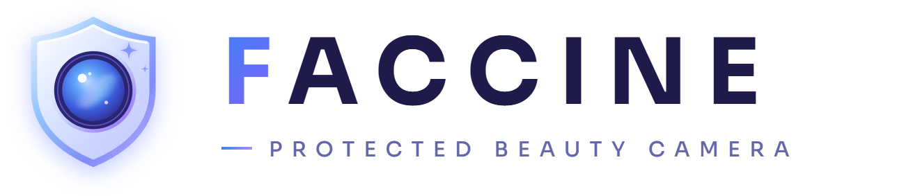
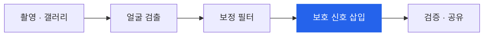

<picture>
  <source media="(prefers-color-scheme: dark)" srcset="logo-dark.png" />
  
</picture>

<br/><br/>


<p><b>보정할 때 함께 지켜지는 딥페이크 방지 카메라</b></p>

<p>
사진을 보정하는 그 순간, 사진 속 모든 얼굴에 보이지 않는 보호막이 씌워집니다.<br/>
얼굴 스왑 딥페이크 도구는 보호된 사진에서 더 이상 당신을 찾지 못합니다.
</p>

<p>


</p>

<p>
<a href="#how-it-works">작동 방식</a> ·
<a href="#results">검증 결과</a> ·
<a href="#getting-started">시작하기</a> ·
<a href="Data/results/comparison.md">전체 리포트</a>
</p>

</div>

<br/>

## Why

딥페이크는 이제 사진 한 장으로 충분합니다. 그런데 사진을 올리기 전에 보호 도구를 따로 챙기는 사람은 거의 없습니다.

페이신은 보호를 **추가 작업**이 아니라 **보정의 일부**로 만듭니다. 사용자는 평소처럼 피부를 보정하고 필터를 고를 뿐이고, 보호는 그 과정에 자연스럽게 따라옵니다.

<br/>

## Features

<table>
<tr>
<td width="50%" valign="top">

**모든 얼굴을 한 번에**
단체 사진 속 친구들의 얼굴까지 자동으로 찾아 함께 보호합니다.

**두 가지 보호 방식**
`그대로` 눈에 띄지 않는 미세 신호만 넣습니다.
`메이크업` 신원 인식을 피하는 메이크업을 자동으로 골라 입힙니다.

</td>
<td width="50%" valign="top">

**보호 리포트**
보호 전후의 신원 유사도와 SNS 압축 후에도 보호가 유지되는지 바로 보여줍니다.

**사진은 기기 밖으로 나가지 않습니다**
모든 처리가 브라우저 안에서 끝납니다. 앱으로 설치하면 오프라인에서도 동작합니다.

</td>
</tr>
</table>

<br/>

<h2 id="how-it-works">How it works</h2>



보호 신호는 성격이 다른 두 얼굴 인식 모델을 **동시에** 속이도록 최적화된 적대적 섭동입니다.
한 모델에만 맞춘 신호는 다른 모델에서 효과가 사라지지만, 여러 모델을 함께 공격하면 실제 얼굴 스왑 도구가 쓰는 ArcFace 계열 신원 인식까지 효과가 이어집니다.

<br/>

<h2 id="results">Results</h2>

LFW 데이터셋 100명에 보호를 적용한 뒤, SNS 업로드를 흉내 내 **JPEG 85%로 압축한 사진**으로 측정했습니다.

| | ArcFace R50 | Glint360K R100 |
|:---|:---:|:---:|
| 보호 안 한 사진 | 0% | 0% |
| **페이신 · 그대로** | **91%** | **88%** |
| **페이신 · 메이크업** | **95%** | **93%** |

<sub>보호 성공률: 보호 전 본인으로 인식되던 사람 중, 보호 후 인식에 실패한 비율</sub>

<details>
<summary>평가 방법</summary>

<br/>

- **시나리오** — 공격자가 보호된 사진을 가져가, 다른 곳에서 구한 같은 사람의 사진과 대조합니다.
- **블랙박스 평가** — 두 평가 모델은 보호 신호를 만들 때 쓰지 않았습니다. ArcFace R50은 얼굴 스왑 도구(inswapper 등)의 신원 인코더이고, Glint360K R100은 학습 데이터가 다른 모델입니다.
- **판정 기준** — 다른 사람 쌍 9,900개 중 1%만 같은 사람으로 통과하도록 데이터로 보정했습니다.
- **강인성** — JPEG 70% 압축과 75% 축소 후에도 측정했습니다.

</details>

<br/>

## Tech stack

| | |
|:---|:---|
| App | Vanilla JS, Vite, PWA |
| Vision | TensorFlow.js, [face-api](https://github.com/vladmandic/face-api), InsightFace ArcFace |
| Protection | 앙상블 적대적 공격(MI-FGSM, EOT), 미분 가능한 얼굴 정렬, 자체 ONNX → TF.js 로더 |
| Evaluation | Puppeteer, onnxruntime-node, LFW |

<br/>

<h2 id="getting-started">Getting started</h2>

```bash
cd Code
npm install
npm run dev     # 첫 실행 시 모델(약 26MB)을 자동으로 내려받습니다
npm run build   # dist/ → HTTPS 정적 호스팅에 올리면 휴대폰에 앱으로 설치됩니다
```

`main` 브랜치에 push하면 GitHub Actions가 GitHub Pages로 자동 배포합니다.

```
Code/           웹앱 (PWA)
Evaluate/       LFW 기반 보호 효과 검증
Data/results/   검증 리포트
```

<br/>

## Roadmap

페이신은 계속 다듬어 가는 중입니다. 다음 단계로 이런 부분을 준비하고 있어요.

- **더 자연스러운 결과물** — 보호 강도를 높였을 때도 사진이 더 깨끗하게 보이도록, 생성 모델 기반의 자연스러운 메이크업 방식을 연구하고 있습니다.
- **더 넓은 보호 범위** — 지금은 얼굴 스왑 도구가 주로 쓰는 ArcFace 계열에서 효과를 확인했고, 다른 인식 모델과 최신 이미지 편집 기술로 검증을 넓혀 갈 예정입니다.
- **모바일 최적화** — 휴대폰에서도 빠르게 동작하도록 실제 기기에서 속도를 측정하고 다듬을 계획입니다.
- **상용화 준비** — 현재 사용하는 InsightFace 모델은 연구용 라이선스라, 서비스 출시에 맞춰 상업적으로 쓸 수 있는 모델로 전환할 예정입니다.

<br/>

<div align="center">
<sub>2026 창업아이디어 경진대회 · Team <code>__init__</code></sub>
</div>
