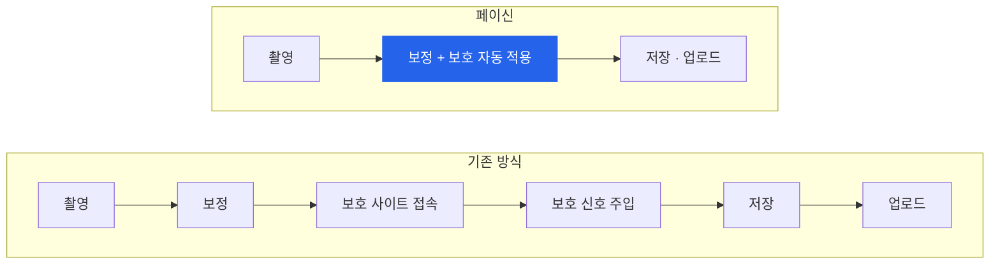

<picture>
  <source media="(prefers-color-scheme: dark)" srcset="logo-dark.png" />
  
</picture>

<h2>보정할 때 함께 지켜지는 딥페이크 방지 카메라</h2>

평소처럼 사진을 보정하면, 사진 속 얼굴에 눈에 잘 띄지 않는 보호 신호가 함께 들어갑니다. 
누군가 내 사진을 가져가도, 딥페이크 도구는 내 얼굴을 쉽게 알아보지 못합니다.

<a href="#problem">문제 정의</a> ·
<a href="#idea">차별성</a> ·
<a href="#build">구현 · 비즈니스 모델</a> ·
<a href="#business">사업화 · 기대효과</a> ·
<a href="#team">팀 소개</a>

 

<h2 id="problem">01. 문제 정의 및 필요성</h2>

### 어떤 문제인가요?

SNS에 올린 평범한 셀카 한 장이 딥페이크 성범죄의 재료가 되고 있습니다.
얼굴 사진 한 장이면 누구나 합성물을 만들 수 있고, 피해는 연예인을 넘어 우리 주변 10·20대 일반인에게까지 번지고 있습니다.

### 현황

| 지표 | 수치 | 출처 |
|:---|:---|:---|
| 딥페이크(합성·편집) 피해 접수 | **1,384건** (2023년 423건 → **227% 증가**) | 여성가족부, 2024 디지털성범죄 피해자 지원 보고서 |
| 딥페이크 피해자 연령 | **92.6%가 10·20대** | 〃 |
| 2025년 합성·편집 피해 | **1,616건** (전년 대비 16.8% 증가, 91.2%가 10·20대) | 성평등가족부, 2025 디지털성범죄 피해자 지원 보고서 |
| 반복 유포로 지원이 계속되는 피해자 | 전년 대비 **26.3% 증가** | 〃 |
| 딥페이크 성범죄 검거 피의자 | **10명 중 6명(62%)이 10대** | 경찰청 집계 (2025.11 보도) |

### 왜 해결되지 않을까요?

- **대응이 사후 중심입니다.** 이미 퍼진 영상물을 찾아 지우는 삭제 지원은 2018년 2만 8천여 건에서 2024년 30만 건 이상으로 10배 넘게 늘었고, 담당 인력 1명이 한 해 2만 건 가까이 처리해야 하는 상황입니다.
- **사전 보호 기술은 있지만 쓰이지 않습니다.** 사진에 보호 신호를 넣어 얼굴 인식을 방해하는 기술은 2020년부터 연구·공개되어 왔습니다. 하지만 사진마다 별도 프로그램이나 사이트에서 따로 변환해야 해서 일상에서는 거의 쓰이지 않습니다.

### 그래서 필요한 것

> 사진을 올리기 직전, **늘 하던 행동 안에서 저절로** 보호되는 방법.

10·20대는 사진을 올리기 전에 보정하는 것이 일상입니다. 페이신은 그 보정 순간에 보호를 함께 넣습니다.

 

<h2 id="idea">02. 아이디어의 창의성 · 차별성</h2>

### 핵심 아이디어

**"평소처럼 보정만 하면, 사진 속 모든 얼굴이 딥페이크로부터 보호됩니다."**

보정 필터 안에 딥페이크 방지 신호(적대적 섭동)가 들어 있어, 필터를 적용하는 순간 보호가 함께 들어갑니다.
보정 시점을 고른 이유는, 보호 신호가 공유 직전의 **최종 사진**에 들어가야 이후 편집으로 지워지지 않기 때문입니다.

### 기존 방식 vs 페이신

| | 기존 사진 보호 연구·도구 | **페이신** |
|:---|:---|:---|
| 사용 방식 | 사진마다 별도 프로그램·사이트에서 변환 | **보정 앱 안에서 자동** |
| 사용자 행동 | 보호를 위해 따로 시간을 들여야 함 | **추가 행동 없음** (보정만 하면 끝) |
| 막는 대상 | 얼굴 인식 학습, 이미지 편집 등 기술별로 다름 | **얼굴 스왑 딥페이크가 쓰는 신원 인식(ArcFace 계열)** 에 맞춰 검증 |
| 사진 처리 위치 | 도구에 따라 서버 업로드 필요 | **기기 안에서만 처리** (사진이 밖으로 나가지 않음) |

### 주요 기능

<table>
<tr>
<td width="50%" valign="top">

**모든 얼굴을 한 번에**
단체 사진 속 친구들의 얼굴까지 자동으로 찾아 함께 보호합니다.

**두 가지 보호 방식**
`그대로` 눈에 띄지 않는 미세 신호만 넣습니다.
`메이크업` 신원 인식을 피하는 메이크업을 자동으로 골라 입힙니다.

</td>
<td width="50%" valign="top">

**보호 리포트**
보호 전후의 신원 유사도와 SNS 압축 후에도 보호가 유지되는지 바로 보여줍니다.

**사진은 기기 밖으로 나가지 않습니다**
모든 처리가 브라우저 안에서 끝납니다. 앱으로 설치하면 오프라인에서도 동작합니다.

</td>
</tr>
</table>

 

<h2 id="build">03. 구현 가능성 · 비즈니스 모델</h2>

### 동작하는 프로토타입

아이디어 단계를 넘어, 휴대폰에 설치해 쓸 수 있는 앱(PWA)으로 구현을 마쳤습니다.

보호 신호는 성격이 다른 두 얼굴 인식 모델을 **동시에** 속이도록 최적화된 적대적 섭동입니다.
한 모델에만 맞춘 신호는 다른 모델에서 효과가 사라지지만, 여러 모델을 함께 공격하면 실제 얼굴 스왑 도구가 쓰는 ArcFace 계열 신원 인식까지 효과가 이어집니다.

| | |
|:---|:---|
| App | Vanilla JS, Vite, PWA (설치형 웹앱, 오프라인 동작) |
| Vision | TensorFlow.js, [face-api](https://github.com/vladmandic/face-api), InsightFace ArcFace |
| Protection | 앙상블 적대적 공격(MI-FGSM, EOT), 미분 가능한 얼굴 정렬, 자체 ONNX → TF.js 로더 |
| Evaluation | Puppeteer, onnxruntime-node, LFW |

### 검증 결과

LFW 데이터셋 100명에 보호를 적용한 뒤, SNS 업로드를 흉내 내 **JPEG 85%로 압축한 사진**으로 측정했습니다.

| | ArcFace R50 | Glint360K R100 |
|:---|:---:|:---:|
| 보호 안 한 사진 | 0% | 0% |
| 1차 시도 (한 모델만 공격) | 0% | – |
| **페이신 · 그대로** | **91%** | **88%** |
| **페이신 · 메이크업** | **95%** | **93%** |

보호 성공률: 보호 전 본인으로 인식되던 사람 중, 보호 후 인식에 실패한 비율

평가 방법

 

- **시나리오** — 공격자가 보호된 사진을 가져가, 다른 곳에서 구한 같은 사람의 사진과 대조합니다.
- **블랙박스 평가** — 두 평가 모델은 보호 신호를 만들 때 쓰지 않았습니다. ArcFace R50은 얼굴 스왑 도구(inswapper 등)의 신원 인코더이고, Glint360K R100은 학습 데이터가 다른 모델입니다.
- **판정 기준** — 다른 사람 쌍 9,900개 중 1%만 같은 사람으로 통과하도록 데이터로 보정했습니다.
- **강인성** — JPEG 70% 압축과 75% 축소 후에도 측정했습니다.
- **개선 과정** — 처음에는 얼굴 인식 모델 하나만 공격해서 다른 모델에는 효과가 없었습니다(0%). ArcFace 계열 모델을 함께 공격하도록 바꿔 91%까지 끌어올렸습니다.

### 비즈니스 모델

| 단계 | 고객 | 제공 | 수익 |
|:---:|:---|:---|:---|
| **1단계 · B2C** | 개인 사용자 | 고급 필터 · 사용 횟수 무제한 | **월 2,900원** 구독 |
| **2단계 · B2B** | 다른 보정·카메라 앱 | 보호 엔진 탑재 (경쟁자를 고객으로) | **SDK** 연간 라이선스 |
| **3단계 · B2B** | 데이팅·커뮤니티 플랫폼 | 업로드되는 프로필 사진 자동 보호 | **API** 1,000장당 과금 |

**왜 B2C부터?** 실제 사용자가 쓰는 기술이라는 증거가 B2B 영업의 근거가 되고, 다양한 사진·필터 조합으로 모델을 고도화할 수 있으며, "우리 학교도 해주세요" 같은 기관 수요로 이어집니다.

### 시장 경쟁력

- **핵심 사용층이 곧 피해층** — 딥페이크 피해자의 92.6%가 10·20대이고, 이들은 보정 앱의 핵심 사용층입니다.
- **보정은 이미 일상** — 10~17세 여학생의 77%가 사진을 올리기 전 외모를 바꾸거나 가린다고 답했습니다 (Dove Self-Esteem Project, 2021).
- **성장하는 인접 시장** — 딥페이크 탐지 시장은 2023년 2.1억 달러에서 2031년 34.6억 달러로 연 41.7% 성장이 예상됩니다 (The Insight Partners).
- **자연 확산** — 보호된 사진에 선택형 '보호됨' 스탬프를 달아, 본 사람이 앱으로 유입되도록 합니다.

 

<h2 id="business">04. 사업화 가능성 · 기대효과</h2>

### 사업화 계획

| 단계 | 시기 | 내용 | 상태 |
|:---:|:---:|:---|:---:|
| 1. 검증 | 2026.11 ~ 12 | 오픈소스 얼굴 인식 모델 대상 방어율 PoC | ✅ LFW 검증 완료 |
| 2. MVP | 2027.01 ~ 02 | 방어율 · 화질 · 블라인드 테스트, 모바일 기기 테스트 | 진행 예정 |
| 3. 출시 | 2027 상반기 | 앱스토어 출시 | |
| 4. 사업 확장 | 2028 ~ | 보정 앱 SDK · 플랫폼 API, 교육청 B2G 계약, 해외 검토 | |

### 기대효과

| | |
|:---|:---|
| **사회** | **지우는 대응에서 막는 대응으로.** 사진이 딥페이크 재료가 되기 전에 보호하고, 피해가 몰린 10·20대를 직접 지킵니다. |
| **사용자** | **불안은 덜고, 공유는 마음 편히.** 내 얼굴이 합성될까 하는 걱정 없이 셀카와 단체 사진을 공유합니다. |
| **산업** | **딥페이크 방지를 보정 앱의 기본 기능으로.** 보정·카메라 앱과 기관에 보호 엔진을 공급해 표준 보호 기능을 목표로 합니다. |

### 앞으로 다듬어 갈 부분

- **더 자연스러운 결과물** — 보호 강도를 높였을 때도 사진이 더 깨끗하게 보이도록, 생성 모델 기반의 자연스러운 메이크업 방식을 연구하고 있습니다.
- **더 넓은 보호 범위** — 지금은 얼굴 스왑 도구가 주로 쓰는 ArcFace 계열에서 효과를 확인했고, 다른 인식 모델과 최신 이미지 편집 기술로 검증을 넓혀 갈 예정입니다.
- **모바일 최적화** — 휴대폰에서도 빠르게 동작하도록 실제 기기에서 속도를 측정하고 다듬을 계획입니다.
- **상용화 준비** — 현재 사용하는 InsightFace 모델은 연구용 라이선스라, 서비스 출시에 맞춰 상업적으로 쓸 수 있는 모델로 전환할 예정입니다.

> 소스 코드와 검증 스크립트는 모바일 기기 테스트를 마친 뒤 공개할 예정입니다.

 

<h2 id="team">Team <code>__init__</code></h2>

> 파이썬의 `__init__`은 무언가가 처음 만들어질 때 가장 먼저 실행되어 기본값을 정합니다. 
> 저희는 안전이 처음부터 기본값인 세상을 만듭니다. **Safe by default.**

| | 이름 | 역할 |
|:---:|:---|:---|
| 🧭 | **김혜현** HyeHyeon Kim | PM · CM · QA |
| 🛠️ | **정가영** GaYeong Jeong | PL · ENG · QA |

 

## References

- 여성가족부 · 한국여성인권진흥원, [2024 디지털성범죄 피해자 지원 보고서](https://www.khan.co.kr/article/202504102017005) 관련 보도 (2025.4)
- 성평등가족부, [지난해 디지털성범죄 피해자 1만 637명에게 35만여 건 원스톱 지원](https://www.mogef.go.kr/nw/enw/nw_enw_s001d.do?mid=mda700&bbtSn=713441) (2026.4), [관련 보도](https://m.sedaily.com/amparticle/20033388)
- 뉴시스, ['딥페이크 성범죄' 1438명 검거…피의자 62%가 10대](https://www.newsis.com/view/NISX20251114_0003403877) (2025.11)
- 경향신문, [디지털성범죄 예산·인력 관련 보도](https://www.khan.co.kr/article/202503111508001) (2025.3)
- Dove Self-Esteem Project, [Reverse Selfie 캠페인 조사](https://www.socialsamosa.com/2021/04/dove-reverse-selfie-campaign) (2021)
- The Insight Partners, [Deepfake AI Detection Market Forecast to 2031](https://www.prnewswire.co.uk/news-releases/deepfake-ai-detection-market-skyrockets-to-3-463-82-million-by-2031-dominated-by-tech-giants---sightengine-clarity-faceonlive-and-busterai--the-insight-partners-302327789.html)
- S. Shan et al., [Fawkes: Protecting Privacy against Unauthorized Deep Learning Models](https://www.usenix.org/conference/usenixsecurity20/presentation/shan), USENIX Security 2020

## Acknowledgments

- [face-api](https://github.com/vladmandic/face-api) (MIT) — 얼굴 검출, 랜드마크, 얼굴 인식 모델
- [TensorFlow.js](https://github.com/tensorflow/tfjs) (Apache-2.0) — 브라우저 안에서의 모델 실행과 보호 신호 계산
- [InsightFace](https://github.com/deepinsight/insightface) — ArcFace 얼굴 인식 모델 (MobileFaceNet, R50, Glint360K R100). 모델은 비상업·연구용 라이선스를 따릅니다.
- [ONNX Runtime](https://github.com/microsoft/onnxruntime) (MIT) — 검증용 모델 실행
- [Labeled Faces in the Wild](http://vis-www.cs.umass.edu/lfw/) — 보호 효과 검증 데이터셋 
  G. B. Huang, M. Ramesh, T. Berg, E. Learned-Miller. *Labeled Faces in the Wild: A Database for Studying Face Recognition in Unconstrained Environments.* UMass Amherst Tech. Report 07-49, 2007.

 

2026 창업아이디어 경진대회 · Team <code>__init__</code>

